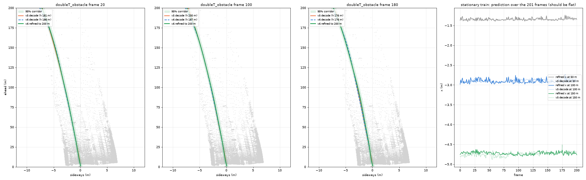
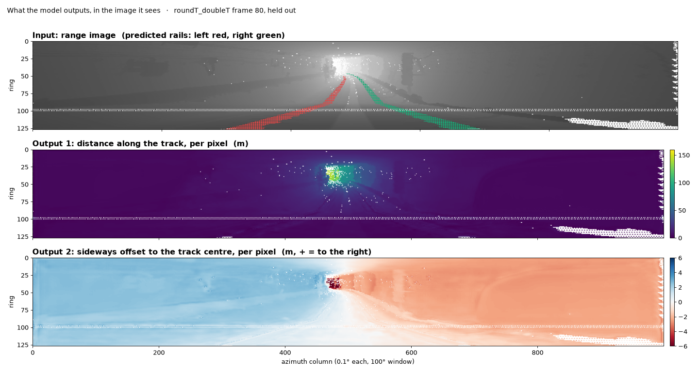
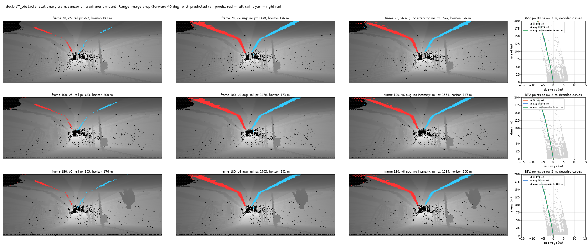

# RailGuard

Where is the track going? RailGuard answers this from a single scan of the train's Hesai Pandar128 LiDAR: it finds the
rails and estimates the track centerline up to 200 m ahead, beyond the range where the rails themselves are visible.
The centerline defines where the train's clearance envelope lies in the tunnel, which is what the obstacle check needs
(see [Obstacle detection](#obstacle-detection)). It runs as one ROS 2 Humble node in a Docker container that also
carries rosbag2 and RViz2.



## Web app

The browser app supports bag playback, per-scan obstacle detection, merged-map
placement, and exporting bags with simulated obstacles. It reads bag files
directly; ROS and `ros2 bag play` are only needed for the separate node/RViz workflow below.

From this repository root, put checkpoints in `weights/` as described below,
put extracted bags under `data/`, then run:

```sh
mkdir -p data outputs
docker compose up -d --build web
```

Open [http://127.0.0.1:8000](http://127.0.0.1:8000). Bags and weights are mounted read-only; exports and
map caches are saved in `outputs/`. GPU support uses the NVIDIA container toolkit.
See the [web-app guide](docs/web-app.md) and [Rerun tools](docs/rerun.md).
Both the web app and ROS node share the same `railpath/` model and
`railpath/obstacle_filter.py` implementation.

## Build

The weights are not in the repository . Put them under `weights/` first (they are
the training outputs `results/path/best.pt` and `results/refine/{last.pt,calib.json}` of the training repository):

```
weights/path/best.pt
weights/refine/last.pt
weights/refine/calib.json
```

Then, from the repository root:

```sh
docker build -t railguard .
```

Requirements on the host: Docker with the NVIDIA container toolkit, an NVIDIA driver ≥ 530. The image contains ROS 2 Humble
(ros-base, rosbag2, RViz2), PyTorch 2.5.1 with CUDA 12.1 and the model weights; it needs no network access at run time.

## Run

Run the following commands from this repository's root (`railguard/`). Put each extracted ROS 2 bag directory
inside `data/`, keeping `metadata.yaml` together with all its `.db3` (or `.mcap`) files:

```text
railguard/
  data/
    cloud_with_fake_obj/
      metadata.yaml
      <recording>.db3
    roundT_doubleT/
      metadata.yaml
      <recording>.db3
```

Create the directory with `mkdir -p data`, then copy or extract your bags there. Do not put the compressed `.zst`
archive alone in this directory: extract it first. `data/` is excluded from Git and Docker builds; bags are mounted
read-only at runtime, not copied into the image.

Start the container once (GPU, host network, `./data` mounted at `/bags`, the host's X server for RViz2):

```sh
xhost +local:root                                   # allow the container to open windows (once per login)
docker run -it --rm --name railguard --gpus all --net host --ipc host \
    -e DISPLAY -v /tmp/.X11-unix:/tmp/.X11-unix \
    --mount type=bind,src="$PWD/data",dst=/bags,readonly railguard
```

The bind mount requires `data/` to exist. Check it with `ls /bags/cloud_with_fake_obj` inside the container.
If an existing container was started with a different mount, exit it and recreate it with the command above;
`docker exec` cannot change an existing container's mounts.

In the container's first terminal, start the node and wait for `listening on /lidar_points`:

```sh
ros2 launch railguard railguard.launch.py
```

Open a second terminal with `docker exec -it railguard bash`, then start RViz:

```sh
rviz2 -d /opt/railguard/ws/install/railguard/share/railguard/rviz/railguard.rviz
```

Open a third terminal with `docker exec -it railguard bash`, then play the example bag:

```sh
ros2 bag info /bags/cloud_with_fake_obj
ros2 bag play /bags/cloud_with_fake_obj
# Optional: slower playback for visual inspection
# ros2 bag play /bags/cloud_with_fake_obj --rate 0.5
```

For this bag, RViz's fixed frame is `hesai_lidar` and the input topic is `/lidar_points`. You should see the gray
LiDAR scan, red segmented rails, green predicted centerline, and orange filtered obstacle points. Replace
`cloud_with_fake_obj` with another directory name to play another bag, for example `/bags/roundT_doubleT`.
This recording has no `/tf` topic, so RViz can show a global **No tf data** warning even while these displays work:
their messages already use the fixed frame `hesai_lidar`. A different-frame transform error on an individual display
should instead be fixed by choosing the correct fixed frame or supplying the actual sensor transform.

The playback and obstacle overlay were checked on this recording; see the
[RViz screenshot and validation notes](docs/cloud_with_fake_obj_validation.md).

For another input topic edit `input_topic` in the config (or pass your own file with `config:=/path/railguard.yaml`);
in RViz2 set *Fixed Frame* to the cloud's frame (`hesai_lidar` in the layout, `lidar_livox` for doubleT_obstacle) and the
LiDAR display's topic.

The image uses a UDP-only DDS profile (`fastdds_udp.xml`, set through `FASTRTPS_DEFAULT_PROFILES_FILE`), so ROS 2
processes on the host can also talk to the container; export the same variable on the host for that (shared memory
between the container's root user and a host user carries no data).

## Topics

| topic                            | type                        | content                                                                                   |
| -------------------------------- | --------------------------- | ----------------------------------------------------------------------------------------- |
| `input_topic` (config)         | `sensor_msgs/PointCloud2` | Pandar128 scan with x, y, z, intensity, ring (ring optional)                              |
| `/railguard/centerline`        | `nav_msgs/Path`           | track centre at 1 m steps up to 200 m ahead, in the frame and stamp of the input cloud    |
| `/railguard/rails`             | `sensor_msgs/PointCloud2` | points segmented as rail                                                                  |
| `/railguard/obstacles`         | `sensor_msgs/PointCloud2` | filtered obstacle XYZ; input cloud's frame and stamp; empty when none remain              |
| `/railguard/obstacle_detected` | `std_msgs/Bool`           | whether any obstacle points remain in this scan                                           |
| `/railguard/obstacle_distance` | `std_msgs/Float32`        | nearest retained point's distance along the predicted track, metres; NaN when none remain |

The subscription has depth 1, so only the newest scan waits while one is processed and the node never falls behind.

## Config

`railguard/config/railguard.yaml` (installed in the image; pass another file with `config:=`):

| parameter          | default                                 | meaning                                                                                                           |
| ------------------ | --------------------------------------- | ----------------------------------------------------------------------------------------------------------------- |
| `input_topic`    | `/lidar_points`                       | input cloud topic                                                                                                 |
| `weights`        | `/opt/railguard/weights/path/best.pt` | vote model                                                                                                        |
| `refiner`        | `/opt/railguard/weights/refine`       | refiner directory (`last.pt`, `calib.json`); empty = no refiner, centerline only as far as the rails are seen |
| `drop_intensity` | `true`                                | the model was trained without intensity                                                                           |

## Repository layout

```
Dockerfile, entrypoint.sh, fastdds_udp.xml   image: ROS 2 Humble ros-base + rosbag2 + RViz2, PyTorch 2.5.1 / CUDA 12.1
railguard/                                   ROS 2 package: node, launch, config, RViz layout
railpath/                                    model inference, refiner, and shared obstacle filtering
obstacle_app/                                browser app, bag reader, simulation backends, map editor
models/                                     obstacle meshes, model descriptions, and previews
tools/, tests/                              visualization utilities and regression checks
Dockerfile.web, compose.yaml                 separate web image/service (port 8000)
requirements-web.txt, requirements-rerun.txt Python dependencies for the web app and viewer utilities
weights/                                     vote model (path/best.pt) and refiner (refine/last.pt, calib.json); not tracked
data/, outputs/                             source bags and generated bags/caches; not tracked
docs/                                        figures used below
```

Training, automatic labelling and evaluation code: [https://github.com/diuzhevVlad/RailGuard_rail_det](https://github.com/diuzhevVlad/RailGuard_rail_det).

## Architecture

```
ROS 2 bag / sensor ──PointCloud2──▶ railguard_node
                                     ├─ range image 128 × 1000 (forward 100°, ring = row)
                                     ├─ vote model (U-Net, ResNet34): rail segmentation + per-pixel vote for the centerline
                                     ├─ clothoid decode: votes binned per metre → curvature-bounded clothoid, vote horizon
                                     └─ refiner: scene-context transformer corrects the curve beyond the evidence, gives sigma
                                                  ──▶ /railguard/centerline, /railguard/rails ──▶ obstacle check, RViz
```

## Algorithm

**Problem.** In a tunnel the rails are visible to about 100–150 m from one scan; the obstacle check needs the track
course further and with a known uncertainty, including on curves, at switches and next to platforms, and without
odometry (single scan).

**Data.** Seven recordings of the organisers' bags. Labels are generated automatically: KISS-ICP odometry over each
recording gives the path the train actually drove; the rails are found near the ground under that path and give, for
every scan, the rail pixels and the true centerline to 200 m ahead. No manual annotation.



**Processing.** (1) The scan becomes a 128 × 1000 range image (x, y, z, range, mask per pixel). (2) A U-Net segments the
two rails and lets every pixel within 12 m of the track vote for the nearest centerline point (offset and arc length);
votes of walls, floor and ceiling carry the curve beyond the visible rails. (3) The votes are binned per metre and a
clothoid chain (piecewise-linear curvature every 25 m, radius ≥ 200 m as in the metro design code) is fitted robustly;
the vote horizon is where the evidence ends. The track height is anchored to the rail pixels. (4) The refiner unrolls
the scan into the frame of that curve, so walls and ceiling become straight ridges when the curvature is right and
drift when it is wrong, and a small transformer with deformable attention corrects the curvature of the knots beyond
the dense evidence and predicts a per-knot uncertainty, calibrated on held-out recordings.

**Robustness.** Training uses synthetic obstacles (people, boxes, wires, train-sized occluders, rendered into the scans),
LiDAR mount jitter (±1.5° yaw, ±1° pitch and roll, ±0.2 m), point dropout and range cuts, and mirroring; intensity is
not used. This keeps the rail segmentation working on a differently mounted sensor (the doubleT_obstacle recording):



**Parameters that affect the result**: the input topic, the refiner on/off (off: faster, line only to the horizon + 20 m),
`drop_intensity` (must match the model).

**Limitations.** Beyond ~150 m the line is an extrapolation (p95 error 13 m at 200 m on curves) and the corridor is
optimistic there (coverage 0.6 at 200 m); switches are ambiguous for a single-curve model; heights beyond the rail
horizon follow a learned prior; the model is trained on one line and one sensor, so a new mount should be checked with a
minute of data first.

## Obstacle detection

The obstacle check consumes `/railguard/centerline` and the input cloud: every return inside the train's clearance
envelope swept along the centerline is an obstacle candidate, and the nearest one gives the distance.
The node runs `railpath/obstacle_filter.py` immediately after inference, using the same scan and model
prediction. This is a standalone NumPy/SciPy port of the web app's filtering; it does not import the app, estimate
odometry, or change the model's rail/centerline outputs. The RViz layout shows retained obstacle points in orange.

Settings in `railguard/config/railguard.yaml` are read at startup (restart the node after editing):

| parameter                         | default   | meaning                                                                  |
| --------------------------------- | --------- | ------------------------------------------------------------------------ |
| `train_width_m`                 | `2.1`   | full envelope width, centred on the predicted track                      |
| `train_height_m`                | `3.0`   | envelope height above the predicted track                                |
| `min_forward_m`                 | `1.5`   | minimum forward depth checked                                            |
| `max_forward_m`                 | `150.0` | maximum forward depth checked; set to 200.0 to use the full refined line |
| `min_height_above_track_m`      | `0.10`  | reject points at or below this height                                    |
| `near_min_height_above_track_m` | `0.20`  | stricter height threshold inside the near region                         |
| `near_height_distance_m`        | `10.0`  | extent of the near region (exclusive)                                    |
| `min_cluster_points`            | `5`     | minimum connected group size                                             |

Coordinates are metres in the LiDAR frame: forward −Y, up +Z. Forward cutoffs use −Y; the reported obstacle distance
uses arc length along the predicted centerline. The model's curve is interpolated at 0.25 m spacing for envelope
queries, without extending it past its finite predictions. Segmented rail points are excluded with a 0.00001 m
numerical matching tolerance. Connections use 3D distance: radius 0.20 m to 30 m, linearly increasing to 0.35 m at
80 m and 0.60 m at 150 m, then constant. A connection must fit both endpoints' radii. Connected groups of at least
five points survive; a chain is sufficient. Far decisions retain the baseline 10 cm rule, including at the 10 m
boundary. The implementation includes bounded neighbor searches, dense-cell shortcuts, and overlapping regional
passes for large envelopes, as in the app.

Each scan publishes an obstacle cloud and both scalar results, including empty/false/NaN results to clear previous
detections. False means no retained points, not a guarantee of a clear track (an unsupported centerline also has no
detections). The scalar topics have no header; use the stamped obstacle cloud when exact synchronization is needed.

```sh
ros2 topic echo /railguard/obstacle_detected
ros2 topic echo /railguard/obstacle_distance
# Pure filtering tests; NumPy and SciPy are sufficient, no ROS/model weights required:
PYTHONPATH=.:railguard python3 -m unittest discover -s tests -p 'test_ros_obstacle_filter.py'
```

## Experiments

Held-out recordings (2,542 scans from three runs never used for training or calibration); lateral error of the centerline
p50 / p95 in metres; single scan.

| distance               | 50 m        | 100 m       | 150 m       | 200 m      |
| ---------------------- | ----------- | ----------- | ----------- | ---------- |
| all scans              | 0.09 / 0.25 | 0.07 / 0.42 | 0.37 / 3.18 | 3.2 / 14.2 |
| 95 % corridor coverage | 0.99        | 0.96        | 0.88        | 0.72       |

Under test-time perturbation of the same scans (100 m p50 / p95): mount jitter 0.10 / 0.41, synthetic obstacles
0.09 / 0.39, a train-sized occluder 0.20 / 1.91 (before the robustness training: 0.54 / 5.06). Rail segmentation IoU at
20–40 m: 0.80 clean, 0.73 with all perturbations combined (before: 0.44). On the stationary doubleT_obstacle recording
(other mount) the centerline varies by at most 0.11 m at 100 m across 201 scans.

Speed: the model takes about 35 ms per scan on a GPU. The node inside the container on a laptop (RTX 3080 Laptop,
Ryzen 9 5900HX), playing roundT_doubleT, publishes the centerline at 8.2 Hz while the cloud arrives at 9.0 Hz (both rates
measured with `ros2 topic hz` on the same machine); a scan that arrives while one is processed is dropped, never queued.

What did not work, in short: row-wise and anchor-based global regression heads memorised the training tunnels; spline
decoding shrank far curves; refiners that only sampled features along the current curve, or fine-tuned the backbone,
gained little; a trainable encoder copy overfitted. What worked: dense voting with distance-balanced loss, the clothoid
decode, and the scene unrolled into the curve's frame.

## Video

<!-- link to the demonstration video -->
