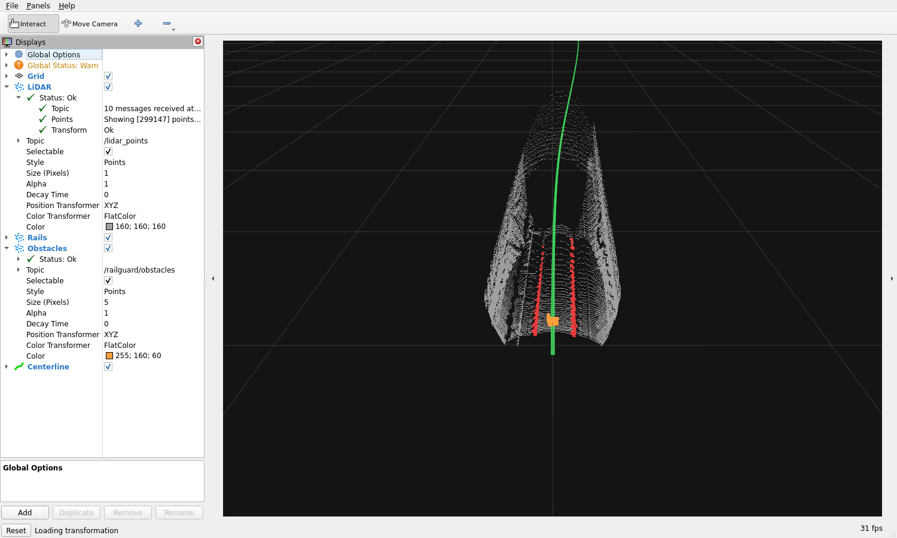

# cloud_with_fake_obj: ROS 2 and RViz validation

Tested 2026-09-28 with the running RailGuard Docker image, model + refiner, and the default obstacle-filter configuration (2.1 m width, 3 m height, 1.5–150 m forward range).

## Bag and mount

- Host: `data/cloud_with_fake_obj/` inside this repository.
- Container: `/bags/cloud_with_fake_obj`, mounted read-only.
- `ros2 bag info`: SQLite3, 1,510 PointCloud2 messages on `/lidar_points`, duration 150.851 s, approximately 6.9 GiB.
- Local test setup reused the existing bag via hard links to avoid duplicating 7 GiB. Both paths refer to the same recording; do not modify either copy. Ordinary users can copy/extract their bags into `data/`.
- The already-running node/RViz container had an empty placeholder mount (`/absolute/path/to/bags`). A temporary bag-player container used the correct mount and host networking to feed that node. The README now uses the concrete `"$PWD/data"` mount and explains recreating a container to change its mounts.

## Checks

1. Played the complete recording once at rate 1.0. The node remained running and continued publishing rail, centerline, obstacle-cloud, detection-flag, and distance topics.
2. Monitored live topics for part of that playback. Received 693 obstacle-cloud messages, including 150 nonempty clouds and empty clouds to clear detections. This is a transport/integration check, not a point-accuracy evaluation or a complete per-frame count: the monitor started after playback began, subscriptions may drop messages, and the inference node intentionally keeps only the latest waiting scan.
3. Replayed slowly and paused on the frame at approximately 36.9 s (input header stamp `946685823833374023` ns), with 5,333 filtered obstacle points. Republished that exact recorded frame for a stable visual inspection after changing the RViz camera.
4. Inspected RViz: gray LiDAR points, red segmented rails, green centerline, orange obstacle cluster. LiDAR and Obstacles both showed **Status: Ok**. The screenshot's LiDAR display shows 299,147 points in this scan.
5. The global **No tf data** warning is expected for this recording, which has no `/tf` messages. All displayed messages use `hesai_lidar`; the LiDAR display explicitly showed **Transform: Ok**.

The inspection camera uses distance 25 m and focal point (0, -5, 0), to show the near obstacle; the standard layout's far-away focal point can put a close obstacle below the window. The repository's default RViz camera was not changed.

